# BulsuScholar Thesis System Flowcharts

This document presents the main BulsuScholar workflows for thesis documentation.
It focuses on the interactions among the Student, Grantor, Administrator, and
System without including low-level implementation details.

The diagrams use standard flowchart shapes: rounded rectangles represent the
start or end, parallelograms represent input or output, rectangles represent a
process, diamonds represent a condition or decision, and circles represent a
connector.

## 1. System Actors

| Actor | Main responsibility |
| --- | --- |
| Student | Creates an account, maintains a profile, submits documents, applies for scholarships, follows application progress, and completes scholarship requirements. |
| Grantor | Publishes scholarship opportunities, reviews applicants, manages scholars, imports official scholar lists, and produces reports. |
| Administrator | Approves accounts, verifies documents, manages grantors, reviews scholarship requirements, resolves conflicts, and oversees the system. |
| Root Admin | Manages privileged settings, Root sessions, and restricted audit/file inventory access. |
| System | Validates information, enforces scholarship rules, manages slots and records, generates notifications, and stores workflow results. |

## 2. Simplified Overall System Flow

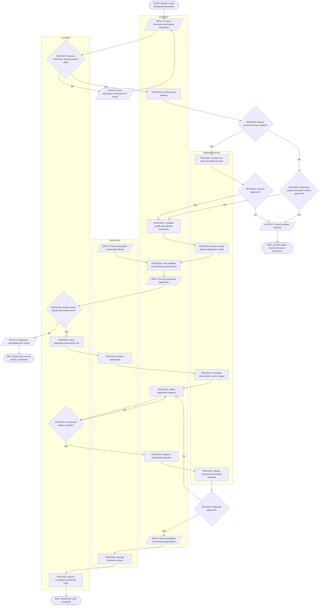

## 3. Authentication and Account Creation

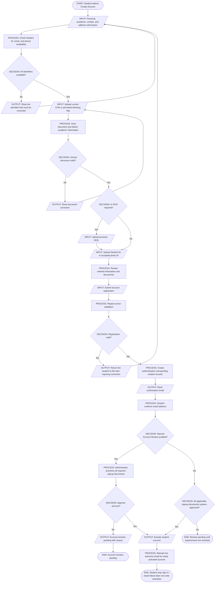

## 4. Student Profile and Document Verification

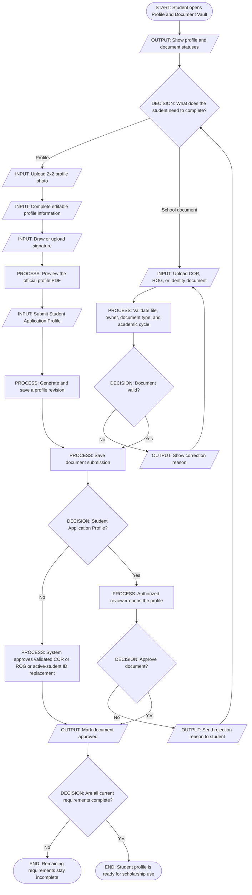

## 5. Scholarship Announcement and Application

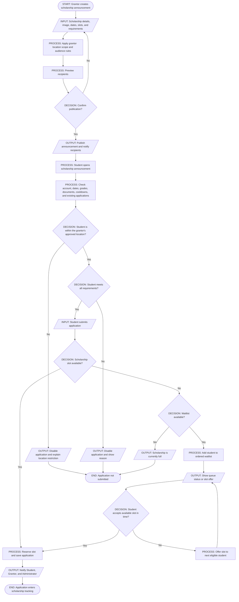

## 6. Standard Scholarship Tracking

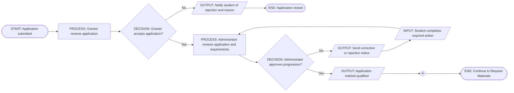

### KWSP Tracking Variation

For KWSP-managed scholarships, the system uses the same application and
document checks but follows the configured KWSP review stages before the
application continues to Request Materials.

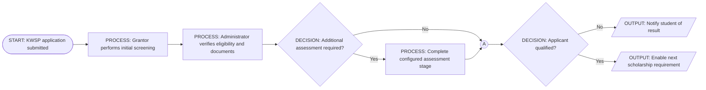

## 7. Request Materials, SOE, and Completion

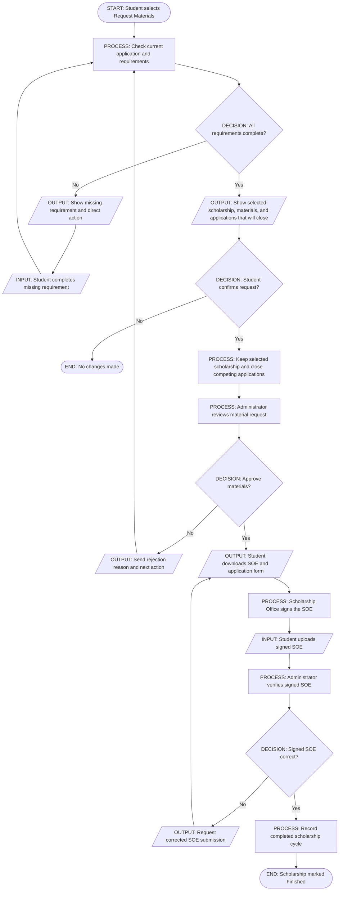

## 8. Official Roster Import and Scholarship Assignment

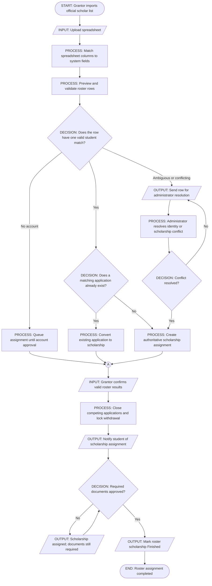

## 9. Grantor Portal Flow

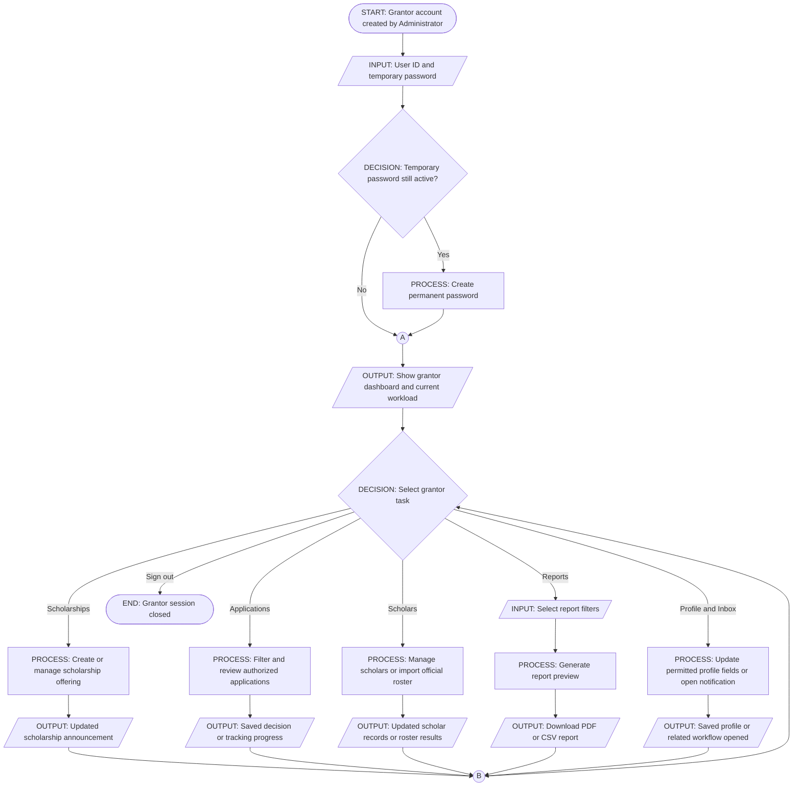

## 10. Administrator Portal Flow

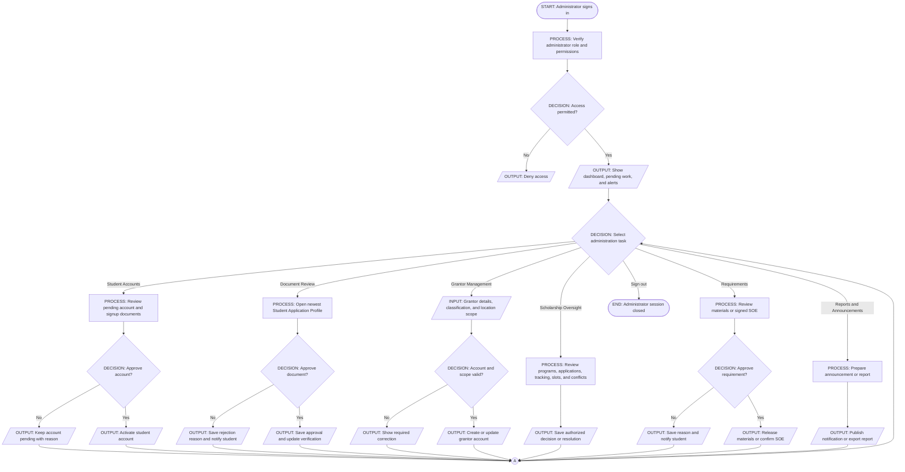

## 11. Protected Sensitive Downloads

All matching connector labels are local to their diagram. An ending means the
current operation finishes, not that the user's whole portal session ends.

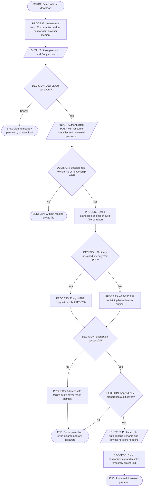

The audit outcome is **prepared**, not proof that the browser saved or opened
the file. Report export history records successful preparation only. Authenticated
previews remain readable and do not create export-history events. A download
never records the signup-document preview required for account approval.

## 12. Password-Assisted PDF Re-upload

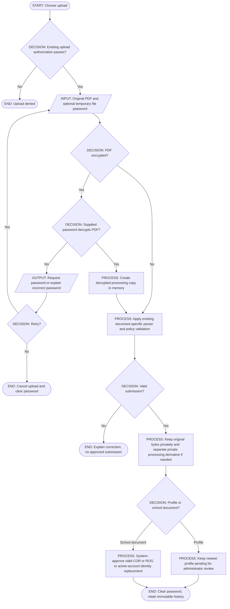

Signup identity verification follows Section 3, not automatic active-account
replacement rules. A processing derivative is not claimed to preserve a digital
signature. The original signed SOE remains authoritative and is archived without
rewriting for download. The password is not saved with either file.
