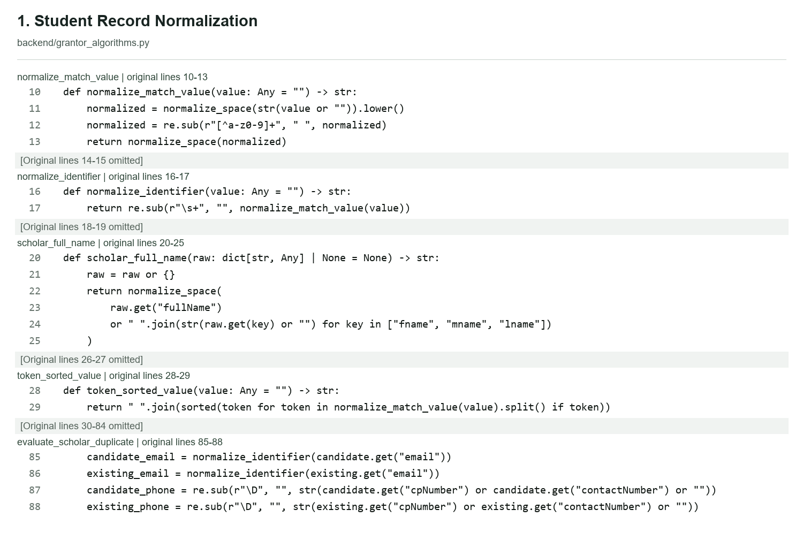
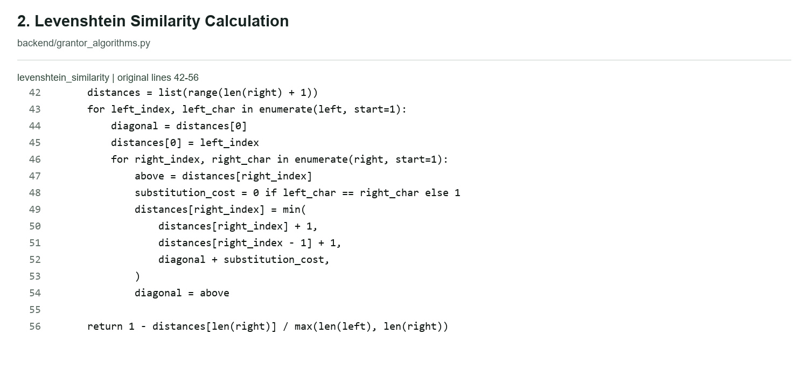
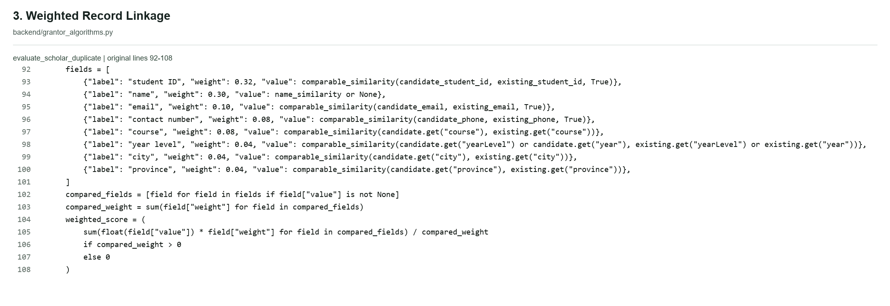
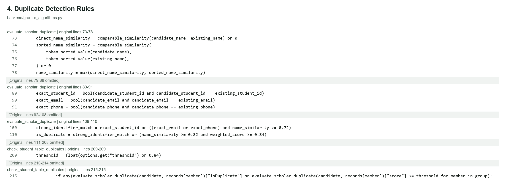
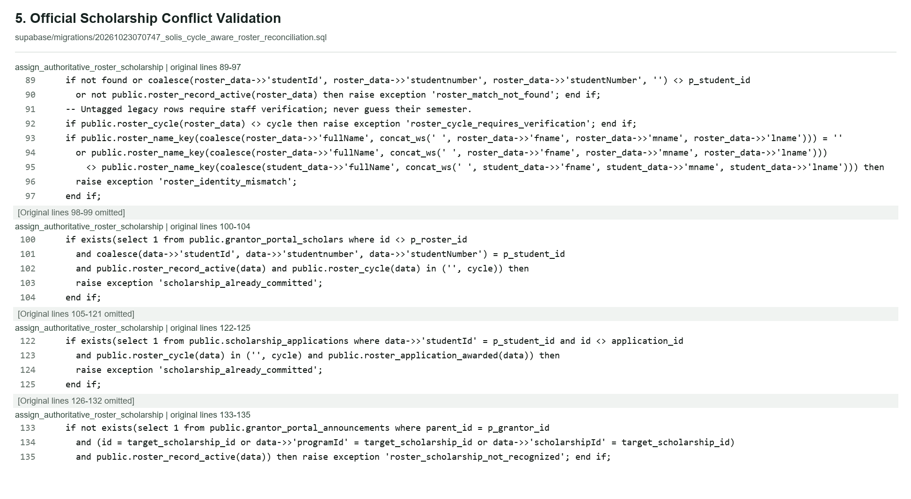

# Duplication Prevention Algorithm: Actual Source Extraction

## A. Actual Source-Code Figures

Static local-source verification only. Original source is unchanged; numbering and omission labels are annotations.

### Figure 1: Student Record Normalization



Figure 3.X. Source-code normalization of student identity fields before duplicate comparison.

`backend/grantor_algorithms.py:10-13` | `normalize_match_value`

```python
def normalize_match_value(value: Any = "") -> str:
    normalized = normalize_space(str(value or "")).lower()
    normalized = re.sub(r"[^a-z0-9]+", " ", normalized)
    return normalize_space(normalized)
```

**Original lines 14-15 omitted.**

`backend/grantor_algorithms.py:16-17` | `normalize_identifier`

```python
def normalize_identifier(value: Any = "") -> str:
    return re.sub(r"\s+", "", normalize_match_value(value))
```

**Original lines 18-19 omitted.**

`backend/grantor_algorithms.py:20-25` | `scholar_full_name`

```python
def scholar_full_name(raw: dict[str, Any] | None = None) -> str:
    raw = raw or {}
    return normalize_space(
        raw.get("fullName")
        or " ".join(str(raw.get(key) or "") for key in ["fname", "mname", "lname"])
    )
```

**Original lines 26-27 omitted.**

`backend/grantor_algorithms.py:28-29` | `token_sorted_value`

```python
def token_sorted_value(value: Any = "") -> str:
    return " ".join(sorted(token for token in normalize_match_value(value).split() if token))
```

**Original lines 30-84 omitted.**

`backend/grantor_algorithms.py:85-88` | `evaluate_scholar_duplicate`

```python
    candidate_email = normalize_identifier(candidate.get("email"))
    existing_email = normalize_identifier(existing.get("email"))
    candidate_phone = re.sub(r"\D", "", str(candidate.get("cpNumber") or candidate.get("contactNumber") or ""))
    existing_phone = re.sub(r"\D", "", str(existing.get("cpNumber") or existing.get("contactNumber") or ""))
```

### B. Explanation

**Purpose:** Standardizes available identity text before comparison. Inputs are names, identifier strings, email addresses and contact numbers.

**Calculation:** normalize_match_value collapses spaces, lowercases text and replaces runs outside ASCII a-z/0-9 with a space. normalize_identifier removes the remaining whitespace. scholar_full_name prefers fullName, otherwise joins fname/mname/lname. token_sorted_value sorts name tokens. Email uses identifier normalization; phone matching strips every non-digit character.

**Decision:** Produces normalized strings, a constructed full name and a token-sorted name. These values feed the matching functions; normalization alone does not approve an identity.

**Limitation:** Email punctuation is removed, so distinct email addresses can collapse to the same key. Accented and non-Latin characters are removed/replaced, not transliterated. This phone comparison does not itself equate local 09 numbers with +63 numbers. Different workflows have different normalizers.

### Figure 2: Levenshtein Similarity Calculation



Figure 3.Y. Dynamic-programming edit distance and normalized Levenshtein similarity.

`backend/grantor_algorithms.py:42-56` | `levenshtein_similarity`

```python
    distances = list(range(len(right) + 1))
    for left_index, left_char in enumerate(left, start=1):
        diagonal = distances[0]
        distances[0] = left_index
        for right_index, right_char in enumerate(right, start=1):
            above = distances[right_index]
            substitution_cost = 0 if left_char == right_char else 1
            distances[right_index] = min(
                distances[right_index] + 1,
                distances[right_index - 1] + 1,
                diagonal + substitution_cost,
            )
            diagonal = above

    return 1 - distances[len(right)] / max(len(left), len(right))
```

### B. Explanation

**Purpose:** Measures character-level similarity after text normalization. Inputs are two normalized strings named left and right.

**Calculation:** A dynamic-programming row calculates minimum insertions, deletions and substitutions, each costing one. The last edit distance is divided by the longer normalized string length; similarity is one minus that ratio.

**Decision:** Returns a similarity value from 0 to 1. The caller compares direct name similarity and token-sorted name similarity and takes the larger value (lines 73-78).

**Limitation:** Lines 32-40, outside this compact extract, normalize inputs and handle empty/equal strings: both empty returns 1, only one empty returns 0, equal returns 1. comparable_similarity (59-65) excludes absent field pairs before this function is used by the weighted matcher. This is text similarity, not proof of identity or measured accuracy.

### Figure 3: Weighted Record Linkage



Figure 3.Z. Attribute weights and available-field normalization in weighted record linkage.

`backend/grantor_algorithms.py:92-108` | `evaluate_scholar_duplicate`

```python
    fields = [
        {"label": "student ID", "weight": 0.32, "value": comparable_similarity(candidate_student_id, existing_student_id, True)},
        {"label": "name", "weight": 0.30, "value": name_similarity or None},
        {"label": "email", "weight": 0.10, "value": comparable_similarity(candidate_email, existing_email, True)},
        {"label": "contact number", "weight": 0.08, "value": comparable_similarity(candidate_phone, existing_phone, True)},
        {"label": "course", "weight": 0.08, "value": comparable_similarity(candidate.get("course"), existing.get("course"))},
        {"label": "year level", "weight": 0.04, "value": comparable_similarity(candidate.get("yearLevel") or candidate.get("year"), existing.get("yearLevel") or existing.get("year"))},
        {"label": "city", "weight": 0.04, "value": comparable_similarity(candidate.get("city"), existing.get("city"))},
        {"label": "province", "weight": 0.04, "value": comparable_similarity(candidate.get("province"), existing.get("province"))},
    ]
    compared_fields = [field for field in fields if field["value"] is not None]
    compared_weight = sum(field["weight"] for field in compared_fields)
    weighted_score = (
        sum(float(field["value"]) * field["weight"] for field in compared_fields) / compared_weight
        if compared_weight > 0
        else 0
    )
```

### B. Explanation

**Purpose:** Combines available comparisons of Student ID, name, email, contact number, course, year level, city and province.

**Calculation:** Each field receives the shown weight. Missing comparison values are excluded, then the weighted similarity sum is divided by the sum of included weights. Name similarity is the maximum of direct-order and token-sorted similarity.

**Decision:** Produces weighted_score, normally between 0 and 1. No comparable fields produces 0. The result is a matching score, not an award decision or probability.

**Limitation:** The expression name_similarity or None excludes a name comparison of exactly zero, as well as absent names. The raw weight total is 1.00 only when all fields are included; missing fields redistribute the effective weights. Name-only identical records can therefore score 1.00. Birthdate and school are not fields in this weighted calculation.

### Figure 4: Duplicate Detection Rules



Figure 3.AA. Pairwise duplicate thresholds and the distinct administrator grouping condition.

`backend/grantor_algorithms.py:73-78` | `evaluate_scholar_duplicate`

```python
    direct_name_similarity = comparable_similarity(candidate_name, existing_name) or 0
    sorted_name_similarity = comparable_similarity(
        token_sorted_value(candidate_name),
        token_sorted_value(existing_name),
    ) or 0
    name_similarity = max(direct_name_similarity, sorted_name_similarity)
```

**Original lines 79-88 omitted.**

`backend/grantor_algorithms.py:89-91` | `evaluate_scholar_duplicate`

```python
    exact_student_id = bool(candidate_student_id and candidate_student_id == existing_student_id)
    exact_email = bool(candidate_email and candidate_email == existing_email)
    exact_phone = bool(candidate_phone and candidate_phone == existing_phone)
```

**Original lines 92-108 omitted.**

`backend/grantor_algorithms.py:109-110` | `evaluate_scholar_duplicate`

```python
    strong_identifier_match = exact_student_id or ((exact_email or exact_phone) and name_similarity >= 0.72)
    is_duplicate = strong_identifier_match or (name_similarity >= 0.82 and weighted_score >= 0.84)
```

**Original lines 111-208 omitted.**

`backend/grantor_algorithms.py:209-209` | `check_student_table_duplicates`

```python
    threshold = float(options.get("threshold") or 0.84)
```

**Original lines 210-214 omitted.**

`backend/grantor_algorithms.py:215-215` | `check_student_table_duplicates`

```python
            if any(evaluate_scholar_duplicate(candidate, records[member])["isDuplicate"] or evaluate_scholar_duplicate(candidate, records[member])["score"] >= threshold for member in group):
```

### B. Explanation

**Purpose:** Classifies candidate identity pairs and, separately, groups records in the administrator duplicate-table check.

**Calculation:** The pair evaluator flags exact nonempty normalized Student IDs; or exact email/phone with name similarity at least 0.72; or name similarity at least 0.82 AND weighted score at least 0.84. The table checker additionally accepts weighted score alone at or above its configurable threshold (default 0.84).

**Decision:** evaluate_scholar_duplicate returns isDuplicate plus the score and match metadata (113-123). check_student_table_duplicates creates potential-duplicate groups; its extra score-only rule is broader than the pair rule.

**Limitation:** These are configured rules, not experimentally demonstrated 72%, 82% or 84% accuracy. The final two source ranges belong to a different function, explicitly identified in the figure. An exact ID can flag even when names disagree. A duplicate flag does not establish an existing scholarship award.

### Figure 5: Official Scholarship Conflict Validation



Figure 3.AB. Exact identity, academic-cycle, recognized-program and current-award guards for official roster assignment.

`supabase/migrations/20261023070747_solis_cycle_aware_roster_reconciliation.sql:89-97` | `assign_authoritative_roster_scholarship`

```sql
  if not found or coalesce(roster_data->>'studentId', roster_data->>'studentnumber', roster_data->>'studentNumber', '') <> p_student_id
    or not public.roster_record_active(roster_data) then raise exception 'roster_match_not_found'; end if;
  -- Untagged legacy rows require staff verification; never guess their semester.
  if public.roster_cycle(roster_data) <> cycle then raise exception 'roster_cycle_requires_verification'; end if;
  if public.roster_name_key(coalesce(roster_data->>'fullName', concat_ws(' ', roster_data->>'fname', roster_data->>'mname', roster_data->>'lname'))) = ''
    or public.roster_name_key(coalesce(roster_data->>'fullName', concat_ws(' ', roster_data->>'fname', roster_data->>'mname', roster_data->>'lname')))
      <> public.roster_name_key(coalesce(student_data->>'fullName', concat_ws(' ', student_data->>'fname', student_data->>'mname', student_data->>'lname'))) then
    raise exception 'roster_identity_mismatch';
  end if;
```

**Original lines 98-99 omitted.**

`supabase/migrations/20261023070747_solis_cycle_aware_roster_reconciliation.sql:100-104` | `assign_authoritative_roster_scholarship`

```sql
  if exists(select 1 from public.grantor_portal_scholars where id <> p_roster_id
    and coalesce(data->>'studentId', data->>'studentnumber', data->>'studentNumber') = p_student_id
    and public.roster_record_active(data) and public.roster_cycle(data) in ('', cycle)) then
    raise exception 'scholarship_already_committed';
  end if;
```

**Original lines 105-121 omitted.**

`supabase/migrations/20261023070747_solis_cycle_aware_roster_reconciliation.sql:122-125` | `assign_authoritative_roster_scholarship`

```sql
  if exists(select 1 from public.scholarship_applications where data->>'studentId' = p_student_id and id <> application_id
    and public.roster_cycle(data) in ('', cycle) and public.roster_application_awarded(data)) then
    raise exception 'scholarship_already_committed';
  end if;
```

**Original lines 126-132 omitted.**

`supabase/migrations/20261023070747_solis_cycle_aware_roster_reconciliation.sql:133-135` | `assign_authoritative_roster_scholarship`

```sql
  if not exists(select 1 from public.grantor_portal_announcements where parent_id = p_grantor_id
    and (id = target_scholarship_id or data->>'programId' = target_scholarship_id or data->>'scholarshipId' = target_scholarship_id)
    and public.roster_record_active(data)) then raise exception 'roster_scholarship_not_recognized'; end if;
```

### B. Explanation

**Purpose:** Blocks an official roster assignment when identity, semester, recognized scholarship or current-cycle award checks fail. Inputs are the target student, grantor and roster identifiers and their stored records.

**Calculation:** The selected roster must have the exact stored Student ID, be active, belong to the current cycle and have the same nonempty normalized full name as the account. Other active rosters or awarded applications in the current or unknown cycle cause a conflict. A recognized active scholarship record is required for a new assignment.

**Decision:** Raises a named exception instead of assigning on failure. Successful assignment occurs later in the same transaction. No Levenshtein score or 72/82/84 threshold is used in these official assignment checks.

**Limitation:** This is a deliberately partial extract: account state, transaction locks, normalized commitment-pointer checks (112-121), existing-assignment idempotency (126-130), active provider check (136-138) and the mutation/history logic are documented in the report, not all shown. Twenty-one original lines are retained to keep each selected SQL condition complete.

## Scope and Evidence

This report follows the updated Task Extract the Figures.txt and documents the current local source code only. Five PNG figures contain original source slices, with source line numbers and explicitly marked omitted ranges. Source files, database records, application code and the thesis manuscript are not modified.

Evidence is static source inspection. No production records, credentials or tokens were read. No database query, live assignment, upload or measured-accuracy experiment was performed. Existing tests were inspected as source only; this report does not claim they were executed or that migrations are deployed.

Important separation: fuzzy identity comparison finds potential record matches; official roster assignment is a different exact-identity, current-cycle, transactional process. The matching helper does not itself prove an active award.

## C1. Actual Fields and Weights

The weighted evaluator compares eight fields only: Student ID 0.32; full name 0.30; email 0.10; contact number 0.08; course 0.08; year level 0.04; city 0.04; province 0.04. Raw weights total 1.00. Source: backend/grantor_algorithms.py:68-110.

Birthdate, school, street, barangay, postal code, income and scholarship status are not weighted attributes here. Some appear in other helper functions: match_address (297-323) checks shared address fields; record_completeness_score (169-191) selects canonical records, not pairwise similarity. Do not mix these helpers into the weighted formula.

Student ID aliases are studentId/studentnumber/studentNumber (79-84). Name uses fullName or fname/mname/lname (20-25). Contact aliases are cpNumber/contactNumber (87-88). Year uses yearLevel/year (98). The weighted matcher reads city and province as flat fields; it does not discover missing nested address values.

comparable_similarity (59-65) returns None if either normalized value is empty. Such fields are omitted from the weighted denominator. A computed zero similarity for a non-name field remains included, but zero name similarity is converted to None at line 94. This implementation detail must not be described as universally counting every nonempty mismatch.

## C2. Formulas and Thresholds

Let N(x) be the text normalizer and d the minimum number of insertions, deletions and substitutions. S(a,b) = 1 - d(N(a),N(b)) / max(len(N(a)),len(N(b))) for nonempty normalized inputs. Direct name similarity and token-sorted similarity are both evaluated; name similarity is their maximum (73-78). Token sorting tolerates reordered name tokens; it can also make different token orders indistinguishable.

Weighted score W = sum(w_i * S_i) / sum(w_i), over fields whose comparison value is not None. W = 0 when the included weight is zero (102-108). This is deterministic rule-based record linkage, not a trained machine-learning classifier.

Pair rule (109-110): duplicate = exact normalized nonempty Student ID OR ((exact normalized email OR exact digit-only phone) AND name similarity >= 0.72) OR (name similarity >= 0.82 AND W >= 0.84). Equality at the threshold is accepted. The 0.90 threshold at line 111 only selects labels for reasons; it is not a duplicate gate.

Admin grouping differs: check_student_table_duplicates defaults threshold to float(options.get("threshold") or 0.84) at line 209. It joins a record when ANY member satisfies the pair rule OR has W >= threshold (215). Thus score-only grouping can bypass the 0.82 name floor. Values are configurable and this code does not validate a 0-1 threshold range; a numeric zero falls back to 0.84 because of or.

72%, 82% and 84% are configuration/decision thresholds, not demonstrated accuracy, precision, recall or probability of a scholarship conflict. This extraction supplies no experimental evidence for those performance claims.

## C3. Checking Order and Match Selection

The pair evaluator does not try Student ID first and run Levenshtein only if the ID is missing or different. It computes direct/sorted name similarities at lines 73-78, normalizes identity fields at 79-88, creates exact-match flags at 89-91, computes the weighted score at 92-108, then evaluates the final Boolean conditions at 109-110. Levenshtein also compares other available text/identifier fields through comparable_similarity.

find_scholar_duplicate (126-148) skips an optional excluded record, evaluates all supplied candidates, and returns the flagged record with the highest weighted score. It has no ambiguity result and no active/inactive scholarship filtering inside it. Equal-score matches keep the first encountered. An exact-ID duplicate can have a lower weighted score than another fuzzy duplicate, so returned best match is not guaranteed to prioritize exact ID.

Admin grouping (206-262) is greedy: a candidate joins the first existing group with any qualifying member, otherwise creates a group. It is input-order-dependent and does not merge already-created groups transitively. Canonical selection prefers real student accounts, then nonarchived records, then more populated fields (162-203). A canonical choice is not verification that other members are the same person.

## C4. Actual Call Paths

src/services/grantorService.js:417-430 posts comparison requests to /grantor/evaluate-scholar-duplicate and /grantor/find-scholar-duplicate. backend/main.py:540-555 calls the Python evaluator/helper. src/services/adminMatchingService.js posts /admin/check-student-duplicates; main.py:577-582 invokes the grouping helper. These endpoints/helpers compare supplied records; their existence must not be presented as an automatic query of all active awards.

The current create/import handler in ProviderDashboard.jsx builds rows and calls previewRosterImportWorkflow (2963-2984); success returns at 2989 and failure throws at 2991. Consequently the older fuzzy import loop below 2992, including calls at 3030 and 3048, is not the normal executed create/import path. Manual create follows the same pattern at 3142-3163. Grantor scholar editing still invokes findScholarDuplicate and blocks a save if a match is found at 3283-3291.

Official creation uses backend/roster_workflow_service.py:210-398 followed by commit_roster_import_batch and assign_authoritative_roster_scholarship in the SQL migration. Backend checks are recomputed against stored records; browser text parsing and fuzzy helpers are not the final authority for official awards.

Signup has a separate comparator in backend/signup_service.py:478-610. It first queries roster rows with the supplied exact ID aliases (578-589), skips archived rows (594-595), then checks normalized ID and name. is_similar_roster_name accepts equal names, >=0.72 direct/sorted similarity, or same last token plus token overlap >=0.5 (549-562); missing expected/actual names return True there. It is not the eight-field weighted comparator and not a substitute for strict official assignment.

## C5. Official Import and Assignment Rules

Import preview first requires an authorized admin/grantor and 1-2000 input rows; a grantor is constrained to their own grantor ID. The academic cycle comes from system_configuration (140-148), and rows declaring another cycle are rejected (225-226). Preview creates canonical current-cycle rows, then validates grantor existence/activity, required identity fields and a recognized scholarship (271-282).

Recognized programs come from nonarchived/nonclosed/nonexpired/noninactive grantor announcements (159-197), grouped by normalized title. More than one stable program ID for a title is ambiguous. Within-batch repeated student/scholarship tuples are blocked; a student targeting more than one grantor/program is conflicting. Existing-account identity is an exact account ID lookup plus normalized full-name equality, not fuzzy similarity (283-291).

The SQL assignment requires an existing unblocked active student account (81-87), exact stored roster Student ID and active roster (88-90), explicit matching cycle (92), and nonempty normalized full-name equality (93-97). ID equality is literal at this point, not the punctuation-removing normalize_identifier helper. SQL roster_name_key lowercases and replaces runs outside ASCII a-z/0-9 with spaces (21-24).

Conflicts include another active roster in current or unknown cycle (100-104); a different live commitment, or unresolved current/unknown-cycle commitment pointer (112-121); or another current/unknown-cycle awarded application (122-125). A recognized active scholarship and active provider are required for a new assignment (133-138). Existing identical authoritative assignments return idempotently before those final provider/program checks (126-130).

The transaction takes global and student advisory locks plus row locks (78-88), preserves or converts a matching current application (105-111), closes competing open current-cycle unawarded applications (161-170), and writes commitment, notification and audit data afterward. Commit rechecks batch ownership/readiness, active cycle and authoritative conflicts (257-324). This static inspection does not prove concurrency behavior on a deployed database.

## C6. Status, Cycle and Review Outcomes

roster_record_active (26-32) excludes archived/rejected flags and the exact statuses archived, rejected, declined, withdrawn, inactive, cancelled, canceled, terminated and expired. Completed/finished are not in that exclusion list. roster_application_awarded (34-42) includes active, accepted, approved, awarded, finished, completed, finalized and protected, plus roster-confirmation/lock/requested-SOE signals.

Therefore a current-cycle completed/finished award can still block another award; do not state that every completed scholarship permits reapplication. Explicitly historical-cycle records are not current-cycle blockers. Untagged active legacy records are treated conservatively as unresolved current-cycle possibilities, not ignored. Inactive/cancelled/terminated records alone do not block through the active-award tests, but any other current commitment/conflict can still block.

Pending applications are not automatically awards. Multiple uncommitted applications can exist subject to other application rules. A pending record carrying a commitment/locking signal is not equivalent to an ordinary pending application. roster_application_blocker (447-473) checks open roster conflicts, commitments, awarded applications and unresolved active rosters before application/waitlist operations (561-582).

Preview outcomes (276-338): scholarship_ambiguous / scholarship_not_recognized / duplicate_import_row / conflicting_active_roster / identity_mismatch / existing_commitment_conflict block the batch. already_imported is idempotent; ready_for_future_account stores a valid roster until account activation; convert_existing preserves a matching application; new_assignment assigns an existing account. An unmatched account is not silently linked to a vaguely similar student.

Reconciliation (196-254) returns none for no current/unknown-cycle roster, attempts assignment for one, and records conflict for multiple or specified assignment errors. Preview identity/award conflicts are saved to roster_assignment_conflicts (370-382). Full Admin review requires role full_admin and a 10-2000-character reason (438-457); SQL repeats role/reason/cycle checks and protects an existing award (327-398). A fuzzy flag alone does not automatically create this official conflict record.

A fuzzy match is a potential identity warning or save restriction depending on its caller. An official roster/award conflict is a server-side assignment/application blocker requiring authorized resolution. Account approval may still succeed with roster assignment unresolved; it must not be described as universally blocked by any fuzzy match (SQL 405-443).

## D. Figure Placement and Evidence Limits

Use the five PNGs in Chapter III under the duplication-prevention implementation discussion. Figure captions use placeholder numbers 3.X through 3.AB; renumber to match your manuscript. Keep each figure legible at full width; use a landscape page for the long SQL and weighted-field lines rather than cropping or rewriting code.

Figures retain original line text, indentation, variables, formulas and thresholds. The left line-number gutter, headings, source/function labels and omission bands are annotations, not inserted implementation. Nonconsecutive blocks are separated explicitly. Function setup and later logic outside each slice remain outside the figure; the manifest lists them as outside-extract context.

For thesis wording: describe weighted record linkage with normalized Levenshtein similarity as potential identity detection. Describe exact Student ID/full-name checks, recognized programs, academic-cycle validation and transactional commitment guards separately as prevention of conflicting official assignments. Do not claim a trained model, universal identity certainty, universal exact-ID-first matching, or measured accuracy based on configured thresholds.

Source_Manifest.json records exact slices and omissions with source SHA-256 hashes. These hashes establish the local extraction version, not deployment or live test success. All tracked file hashes are checked again after generation to ensure the extraction did not change existing project files.
