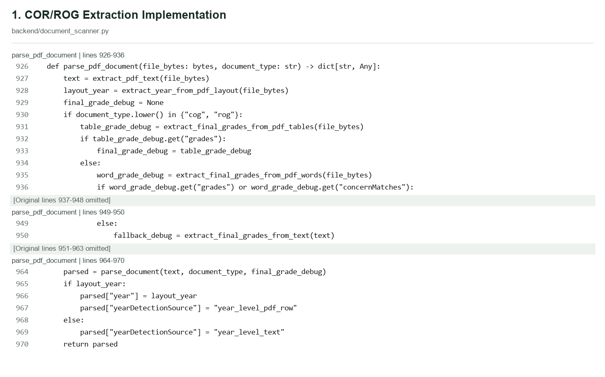
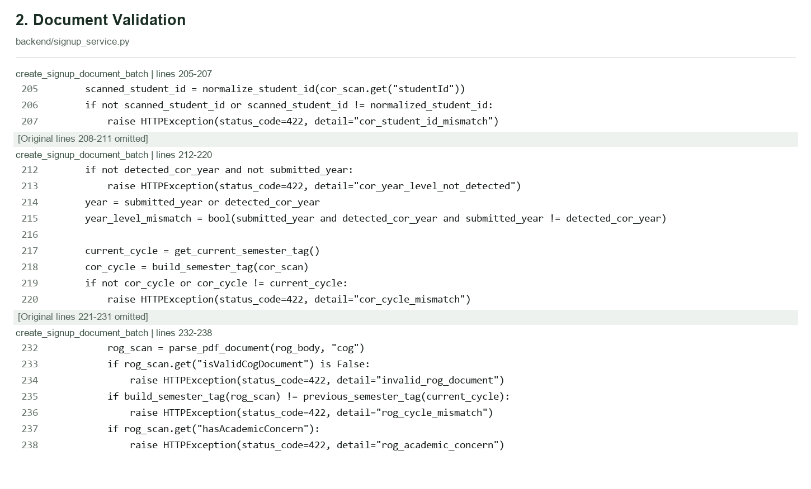
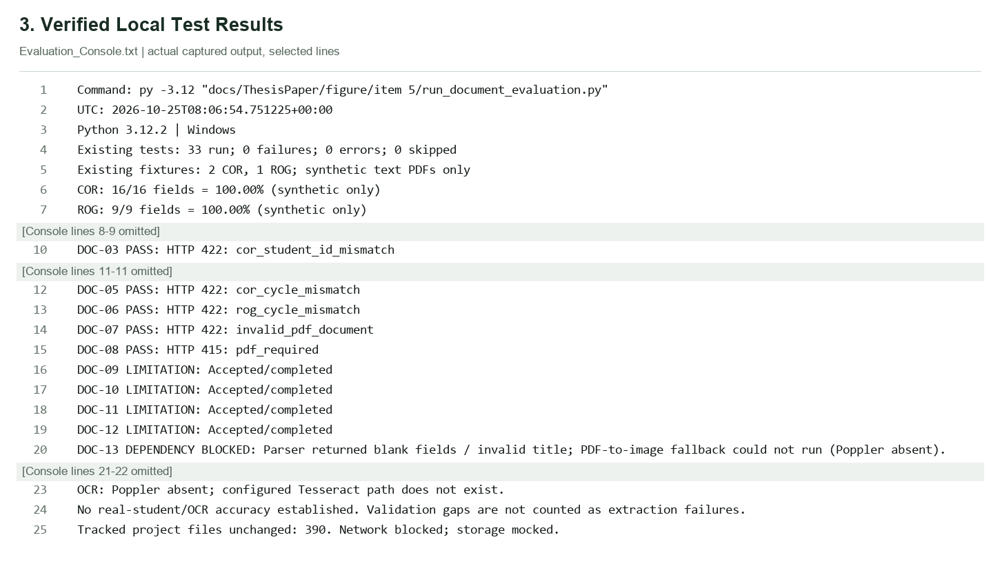

# COR/ROG Extraction and Validation: Evidence-Based Evaluation

## COR/ROG Extraction and Validation Evaluation

A local evaluation was executed on 2026-10-25T08:06:54.751225+00:00. It used the unchanged parser and three existing PDFs under docs/qa, visibly labelled with TEST identities: two CORs and one ROG. Network connections were blocked; storage/database functions were mocked in memory. No production document, database record or external OCR service was used.

All 25 selected, present field comparisons matched their independently transcribed reference values: COR 16/16 and ROG 9/9. These are tiny synthetic text-PDF results, not real-student, OCR, issuer-authenticity or deployment accuracy. Name parts and full names are correlated outputs, not independent student trials.

The final focused existing-test selection ran 33 tests with 0 failures, 0 errors and 0 skips. Many workflow tests mock the parser; their pass count is not extraction accuracy. Fifteen separate parser/workflow scenarios produced 9 PASS, 4 LIMITATION and 2 DEPENDENCY BLOCKED results.

Four limitations were reproduced with the actual parser and in-memory workflow dependencies: profile COR replacement accepted another Student ID; profile ROG replacement accepted an incorrect period; signup accepted a COR without course; signup accepted a ROG with a different Student ID. These are not counted as successful safeguards.

OCR is implemented but was not operational in this Windows environment: Poppler was absent and the configured /usr/bin/tesseract path did not exist. The health helper nevertheless reported Tesseract installed. No OCR or document-processing dependency was installed to change the results.

## A. Actual Implementation

COR/ROG processing is rule-based document extraction, not Levenshtein matching or a trained classifier. parse_pdf_document calls pdfplumber embedded-text extraction and PDF-layout year detection. For ROG/COG, it tries grade table cells, word-coordinate Final/Remarks columns, then text heuristics. parse_document returns labelled identity/academic fields and title/concern flags.

OCR path: when the combined text from all PDF pages is empty, extract_pdf_text uses pdf2image at 220 dpi and ocr_image calls local pytesseract after grayscale/autocontrast. If any embedded text exists, that fallback is skipped, including for mixed text/scanned PDFs. A conversion failure is caught and returns empty text; missing Tesseract raises RuntimeError. No external OCR API appears in this path.

COR/ROG upload routes require PDFs. Scanned PDFs are supported in design only when Tesseract and Poppler are available. Generic image extraction exists, but PNG/JPEG/WebP COR/ROG uploads are not supported by the current route policy. Images are allowed for identity uploads; that does not make them supported academic-document uploads.

The extraction dictionary contains studentId, fullName, firstName, middleName, lastName, course, year, section, gwa, academicYear and semester, plus documentType, title flags and ROG concern fields. middleName is always returned blank by the current name helper. GWA is read from printed labels/nearby text, not recomputed. Semester extraction explicitly recognizes first/second semester, not Summer.

Title recognition searches normalized document text for Certificate of Registration/Advising Slip or Report of Grades. A matching phrase is not proof of an authentic document, issuer, signature or complete fields. DOC-15 demonstrates that a title can be recognized while Student ID, course and year are blank.

Signup requires a matching nonempty COR ID, usable detected or declared year, current COR cycle and configured title policy; nonexempt ROG requires a recognized title, previous cycle and no detected academic concern. First-year first-semester students are exempt from ROG. Declared/detected year disagreement is saved for review rather than always rejected. Final validate_student_signup adds batch/identity and ROG-year progression rules; the isolated batch scenarios do not execute final account activation.

Profile replacement has materially weaker academic checks: upload_student_document validates type/size and COR policy/title or ROG title, then calls automatic approval. It does not recheck scan owner, academic period or ROG concerns there. The static source and DOC-09/DOC-10 show this discrepancy. Automatic approval is not evidence that these omitted rules passed.

Malformed PDF bytes are rejected by processing_pdf with HTTP 422 invalid_pdf_document in the tested upload path. File-read/type/size errors and OCR failures are distinct. Do not claim all parser or decoder exceptions are uniformly converted into one friendly error on every route: scan_document specifically catches RuntimeError, and other exceptions can propagate.

## A1. Function Inventory and Original References

Line numbers and whole-function boundaries come from the current Python AST. Fields are extracted outputs, not proof that every upload route requires or verifies them. See Source_Manifest.json for reviewed-file hashes and exact figure slices.

### backend/document_scanner.py

| backend/document_scanner.py / Function / lines | Purpose / input format | Extracted fields / result | Actual checks / limitations |
|---|---|---|---|
| configure_tesseract_command 39-52 | Selects OCR executable Formats: Runtime dependency | Executable path | Accepts the first nonempty candidate string; does not verify path existence. |
| get_scanner_dependency_status 58-64 | Reports scanner prerequisites Formats: Runtime dependency | Tesseract/Poppler/pdf2image availability | Reported Tesseract availability can be true for a nonexistent configured path. |
| ocr_image 111-120 | OCR pre-processing and recognition Formats: Pillow-readable image object | Text | Grayscale + autocontrast; missing executable raises tesseract_not_installed. |
| extract_pdf_text 123-137 | Reads PDF page text, then optional OCR Formats: PDF bytes | Text | OCR only if combined embedded text is empty; conversion errors return empty string. |
| extract_image_text 140-142 | Loads an image and calls OCR Formats: Generic image bytes; not COR/ROG upload permission | Text | Uses Pillow and OCR helper; errors propagate. |
| find_first 145-150 | Regex field utility Formats: Already extracted text | First capture value | First matching expression wins; no authenticity verification. |
| detect_cor_document_title 153-180 | Recognizes COR/advising title text Formats: Extracted text from PDF | Title and isValidCorDocument | Finds Advising Slip or Certificate of Registration anywhere in normalized text, not verified issuer/title position. |
| detect_cog_document_title 183-205 | Recognizes Report of Grades text Formats: Extracted text from PDF | Title and isValidCogDocument | Requires Report of Grades text; COG/ROG is an internal alias, not support for arbitrary transcript titles. |
| extract_course 208-234 | Canonical course identification Formats: Extracted text | Course | Known course names, abbreviation map, then Bachelor regex fallback. |
| parse_year_level_value 245-261 | Normalizes year-level values Formats: Text | Year level | Recognizes numeric/ordinal/word years one through four. |
| extract_year 264-292 | Finds labelled year level Formats: Extracted text | Year level | Uses year-level context rather than treating an academic year as student year. |
| extract_year_from_positioned_words 295-315 | Reads year label row Formats: PDF positioned-word dictionaries | Year level | Finds value by coordinate proximity; regression fixtures are synthetic dictionaries. |
| extract_year_from_pdf_layout 318-327 | PDF layout year fallback Formats: PDF bytes | Year level | Attempts pdfplumber word layout; failures return empty string. |
| extract_section 330-341 | Section matching Formats: Extracted text | Section | Regex extraction; returns blank when absent. |
| extract_gwa_result 344-407 | Finds printed GWA using labels/context Formats: Extracted text | GWA and debug rules | Heuristics match 1-5 grade-like values; does not recompute GWA from subject units. |
| extract_gwa 410-411 | Returns printed GWA Formats: Extracted text | GWA | Returns extract_gwa_result value. |
| normalize_grade_token 417-428 | Normalizes grade tokens Formats: Text | Grade token | Uppercases text, normalizes comma decimals and whitespace. |
| is_grade_token 431-432 | Checks supported final-grade token Formats: Text | Boolean | Recognizes numeric grade/concern token patterns. |
| grade_debug_from_grades 435-455 | Builds final-grade concern result Formats: Parsed grade lists | Grades, concernMatches, debug | Concern set: 4/5 variants, INC, UD, OD; includes Failed remarks matches. |
| extract_final_grades_from_pdf_tables 458-531 | First ROG grade path Formats: PDF bytes | Final grades/remarks/debug | Reads table Final column; avoids unit/average rows through heuristics. |
| extract_final_grades_from_pdf_words 534-658 | Second ROG grade path Formats: PDF bytes | Final grades/remarks/debug | Uses Final/Remarks column coordinates when table cells fail. |
| extract_final_grades_from_text 661-731 | ROG text fallback Formats: Extracted text | Final grades/remarks/debug | Header-anchored heuristics; skips URL/footer/average lines; not a full transcript authenticity check. |
| clean_name_candidate 73-83 | Removes label noise from name text Formats: Text | Name candidate | Cuts selected academic labels; retains selected name punctuation/letters. |
| is_likely_name_candidate 86-93 | Filters name candidates Formats: Text | Boolean | Checks token count/blocked words and letter pattern; later extraction has additional fallback paths. |
| collect_labeled_name 96-108 | Collects split labelled names Formats: Text lines | Name candidate | Looks at limited following lines; stops at academic labels. |
| extract_name 733-816 | Selects a name and parses parts Formats: Extracted text | Full/first/last name; middleName blank | Handles comma/space forms; middleName output is always blank, not a complete multi-part-name parser. |
| extract_semester 819-873 | Reads academic year and term Formats: Extracted text | academicYear, semester | Supports first/second semester patterns; no explicit Summer term extraction branch. |
| extract_flags 876-884 | Converts grade concerns to flags Formats: Text/grade debug | hasAcademicConcern, academicConcernTerms | Only called for ROG/COG by parse_document. |
| parse_document 887-923 | Builds common extraction dictionary Formats: Already extracted text | studentId, names, course, year, section, gwa, academicYear, semester, flags/title | Student ID regex removes hyphens; title flags are classification, not overall acceptance. |
| parse_pdf_document 926-970 | Main document parser Formats: PDF bytes | Common fields plus yearDetectionSource | ROG table -> positioned-word -> text fallback; layout year overrides text year. |

### backend/signup_service.py

| backend/signup_service.py / Function / lines | Purpose / input format | Extracted fields / result | Actual checks / limitations |
|---|---|---|---|
| _read_signup_file 142-157 | Signup type/size checks Formats: COR/ROG PDF; identity PDF/PNG/JPEG/WebP | File bytes/MIME | Required/nonempty; max 10 MiB; allowed MIME; PDF MIME or .pdf filename check for academic files. |
| create_signup_document_batch 172-306 | Pre-signup document validation/storage Formats: COR/ROG PDF; supported identity files | Scan metadata and signup batch | COR ID/year/cycle/title/policy; ROG title/previous-cycle/concerns. ROG ID not compared. |
| build_semester_tag 333-338 | Canonical academic-cycle string Formats: Parsed scan dictionary | Cycle tag | Combines year and normalized semester; returns blank if required components absent. |
| expected_previous_rog_year_level 399-406 | Expected previous ROG year Formats: Current year/cycle | Expected ROG year | Encodes semester-dependent progression policy. |
| validate_student_signup 633-820 | Final signup revalidation Formats: Saved batch and signup payload | Accepted/rejected result | Rechecks identity/batch/current COR/prior ROG period and year rules; not a universal required-field checker. |

### backend/student_profile_service.py

| backend/student_profile_service.py / Function / lines | Purpose / input format | Extracted fields / result | Actual checks / limitations |
|---|---|---|---|
| upload_student_document 885-967 | Profile replacement upload Formats: COR/ROG PDF only; identity PDF/PNG/JPEG/WebP | Saved scan/submission | 10 MiB, supported MIME, COR policy/title or ROG title. Does not recheck scanned owner/cycle/ROG concerns. |
| _system_approve_submission 802-843 | Automatic review metadata Formats: Already parsed submission | Approved status/review/audit/compatibility | Marks accepted academic replacements approved; it is not an additional identity/period parser validator. |

### backend/main.py

| backend/main.py / Function / lines | Purpose / input format | Extracted fields / result | Actual checks / limitations |
|---|---|---|---|
| scan_document 1554-1610 | Public extraction endpoint Formats: COR/ROG PDF; generic other-kind images | Extracted dictionary | Rejects empty/oversize/unsupported upload types; handles OCR RuntimeError. Does not enforce student ownership/cycle. |

### backend/download_protection.py

| backend/download_protection.py / Function / lines | Purpose / input format | Extracted fields / result | Actual checks / limitations |
|---|---|---|---|
| processing_pdf 93-112 | PDF structural/password processing Formats: PDF bytes | Plain processing copy; original retained by caller | Malformed PDF -> 422 invalid_pdf_document; encrypted PDF needs correct password; derivative size check. |

## B. Existing Evidence and Executed Tests

Evidence located before this run: test_document_scanner.py contains five text/layout unit tests; its successful parser call asserts year only. test_signup_identity_documents.py uses synthetic scan dictionaries and mocks parse_pdf_document. Upload regression tests also mock parsing and persistence. pdf_fixtures.valid_pdf creates a blank PDF, not a reference COR/ROG.

The three small docs/qa PDFs are ReportLab-produced, contain TEST names and have visible reference labels. They were suitable for a limited synthetic field evaluation after reading the references independently of the scanner. Existing signup UI screenshots demonstrate that artifacts exist, not a per-field accuracy measurement or a reproducible earlier test pass.

No earlier machine-readable COR/ROG field-accuracy results with reference values and recorded parser outputs were located in the inspected project artifacts. Prior thesis/revision report generators explicitly distinguish matching tests from missing document-extraction evidence. Existing test definitions alone were not counted as previously executed passes.

Final executed selection: five scanner tests; eleven signup identity/document tests; six upload regression tests; eight profile requirement tests; one automatic COR upload policy test; two malformed/password PDF processing tests. See Existing_Test_Execution.txt for the exact names, console output and elapsed time.

Harness history is retained honestly. The first network guard also blocked Windows asyncio internal socketpairs, giving 16 harness errors; it was corrected only in the new offline runner. A subsequent 34-test selection had one unrelated profile-form test attempt an unmocked draft lookup, which was blocked before network access. Broader_Test_Execution.txt records that error. The final 33-test selection excludes that unrelated profile-form test rather than claiming it passed.

Execution command (from the repository root): py -3.12 "docs/ThesisPaper/figure/item 5/run_document_evaluation.py"

Environment: Python 3.12.2; Windows-11-10.0.26300-SP0. Packages: pdfplumber 0.11.5, pytesseract 0.3.13, pdf2image 1.17.0, pillow 11.0.0, fastapi 0.115.6, pypdf 6.1.1, reportlab 4.5.1.

Final execution UTC: 2026-10-25T08:06:54.751225+00:00 to 2026-10-25T08:07:00.335985+00:00. Local timezone is UTC+08:00. The raw logs record the exact UTC timestamps and actual console results. Dockerfile targets Python 3.11-slim and installs Tesseract/Poppler, but this evaluation used local Python 3.12.2, not that deployed container.

## C. Field Accuracy on Existing Synthetic PDFs

Field Accuracy (%) = (Correctly Extracted Fields / Total Evaluated Fields) x 100. Two COR files had eight present reference fields each; one ROG had those eight plus printed GWA. Thus COR = 16/16 x 100 = 100.00%; ROG = 9/9 x 100 = 100.00%; combined = 25/25 x 100 = 100.00%, on these three synthetic text documents only.

The eight common fields were Student ID, first name, last name, full name, canonical course, year level, academic year and semester. CORs had no GWA; the three documents had no section or middle-name reference. Those absent fields were excluded from the denominator, not credited as correct blanks. Title recognition and academic flags were evaluated separately. Field_Comparisons.csv and Evaluation_Results.json contain every expected/actual value.

References were transcribed from the visibly synthetic source PDFs before consulting scanner output. Name references account for the printed surname-first comma form; BSIT maps to its full course name; semester capitalization is ignored. Student ID uses exact trimmed comparison, while other expected canonical strings use trimmed case-insensitive equality. No manual correction was applied to actual output.

Synthetic negative variants are additional scenario inputs, not extra independent reference documents and not part of the 25-field denominator. They were generated in memory by deleting/changing explicit labels in the TEST text. The OCR probes also remain outside the text-only field metric and are reported as dependency-blocked, not successful extractions.

Quantitative document extraction accuracy on real-student or scanned documents could not be established from the available evidence. The 100.00% synthetic-fixture score must not be presented as the system's general extraction accuracy. The sample lacks varied layouts, scans, multi-page grade tables, non-Latin/complex names and difficult 7/1 characters.

| Document type | Test documents | Evaluated fields | Correct fields | Field accuracy | Validation result |
|---|---|---|---|---|---|
| COR | 2 | 16 | 16 | 100.00% | Title recognized; isolated signup baseline accepted. Other validation scenarios reported separately. |
| ROG | 1 | 9 | 9 | 100.00% | Title recognized; isolated signup baseline accepted. Other validation scenarios reported separately. |

## C1. Every Evaluated Field: Reference vs Output

The following records contain only visibly synthetic TEST identities. Raw originals remain unchanged. The complete scanner dictionaries, including absent fields and flags, are preserved in Evaluation_Results.json; these tables do not suppress incorrect outputs.

| Fixture | Field | Expected canonical value | Actual extracted value | Match |
|---|---|---|---|---|
| first-year-cor.pdf | studentId | 20260001 | 20260001 | Correct |
| first-year-cor.pdf | firstName | Student | Student | Correct |
| first-year-cor.pdf | lastName | Test | Test | Correct |
| first-year-cor.pdf | fullName | Student Test | Student Test | Correct |
| first-year-cor.pdf | course | Bachelor of Science in Information Technology | Bachelor of Science in Information Technology | Correct |
| first-year-cor.pdf | year | 1 | 1 | Correct |
| first-year-cor.pdf | academicYear | 2026-2027 | 2026-2027 | Correct |
| first-year-cor.pdf | semester | 1st | 1st | Correct |
| upper-year-cor.pdf | studentId | 20260002 | 20260002 | Correct |
| upper-year-cor.pdf | firstName | Upper | Upper | Correct |
| upper-year-cor.pdf | lastName | Test | Test | Correct |
| upper-year-cor.pdf | fullName | Upper Test | Upper Test | Correct |
| upper-year-cor.pdf | course | Bachelor of Science in Information Technology | Bachelor of Science in Information Technology | Correct |
| upper-year-cor.pdf | year | 2 | 2 | Correct |
| upper-year-cor.pdf | academicYear | 2026-2027 | 2026-2027 | Correct |
| upper-year-cor.pdf | semester | 1st | 1st | Correct |
| upper-year-rog.pdf | studentId | 20260002 | 20260002 | Correct |
| upper-year-rog.pdf | firstName | Upper | Upper | Correct |
| upper-year-rog.pdf | lastName | Test | Test | Correct |
| upper-year-rog.pdf | fullName | Upper Test | Upper Test | Correct |
| upper-year-rog.pdf | course | Bachelor of Science in Information Technology | Bachelor of Science in Information Technology | Correct |
| upper-year-rog.pdf | year | 1 | 1 | Correct |
| upper-year-rog.pdf | academicYear | 2025-2026 | 2025-2026 | Correct |
| upper-year-rog.pdf | semester | 2nd | 2nd | Correct |
| upper-year-rog.pdf | gwa | 1.50 | 1.50 | Correct |

## D. Document Validation and Capability Scenarios

PASS means the observed behavior matched that scenario's expectation, including an expected rejection. LIMITATION means an exploratory required safeguard was absent or the parser/workflow tolerated an absent field. DEPENDENCY BLOCKED is not a pass. These are isolated function-level tests, not authenticated browser or production acceptance tests.

| Test ID | Document type | Test condition | Expected result | Actual result | Status |
|---|---|---|---|---|---|
| DOC-01 | COR | Existing first-year text PDF; real parser + isolated signup | Accept COR; first-year first-semester ROG exemption | Accepted/completed | PASS |
| DOC-02 | COR + ROG | Existing upper-year text PDFs; real parser + isolated signup | Accept current COR and previous-cycle ROG | Accepted/completed | PASS |
| DOC-03 | COR | Signup Student ID differs from COR | Reject cor_student_id_mismatch | HTTP 422: cor_student_id_mismatch | PASS |
| DOC-04 | COR | Synthetic variant missing year; no declared year | Reject cor_year_level_not_detected | HTTP 422: cor_year_level_not_detected | PASS |
| DOC-05 | COR | Synthetic variant with previous academic year | Reject cor_cycle_mismatch | HTTP 422: cor_cycle_mismatch | PASS |
| DOC-06 | ROG | Synthetic variant not in required previous cycle | Reject rog_cycle_mismatch | HTTP 422: rog_cycle_mismatch | PASS |
| DOC-07 | COR | Malformed PDF bytes through upload processing | Reject invalid_pdf_document | HTTP 422: invalid_pdf_document | PASS |
| DOC-08 | COR | Standalone image upload to profile COR route | Reject pdf_required | HTTP 415: pdf_required | PASS |
| DOC-09 | COR | Existing COR uploaded under another synthetic profile owner | Should not approve a different Student ID (exploratory safeguard expectation) | Accepted/completed | LIMITATION |
| DOC-10 | ROG | Wrong-cycle ROG uploaded through profile replacement | Should not approve wrong academic period (exploratory safeguard expectation) | Accepted/completed | LIMITATION |
| DOC-11 | COR | Synthetic variant missing course | Observe parser output and whether signup requires the missing field | Accepted/completed | LIMITATION |
| DOC-12 | ROG | ROG Student ID differs from signup/COR Student ID | Should reject a wrong-owner ROG (exploratory safeguard expectation) | Accepted/completed | LIMITATION |
| DOC-13 | COR | Image-only synthetic PDF through real parser | Use configured OCR fallback if runtime dependencies exist | Parser returned blank fields / invalid title; PDF-to-image fallback could not run (Poppler absent). | DEPENDENCY BLOCKED |
| DOC-14 | Generic image | Direct image OCR helper on synthetic PNG | OCR if Tesseract executable exists; COR/ROG image upload remains unsupported | RuntimeError: tesseract_not_installed: Tesseract OCR is required for image-based PDFs and image uploads. Redeploy the backend using the repository Dockerfile so tesseract-ocr and poppler-utils a | DEPENDENCY BLOCKED |
| DOC-15 | COR | Title/period only: no identity, course, or year level | Expose absent fields; title recognition is not full validation | studentId=''; course=''; year=''; titleValid=True | PASS |

Observed limitation details: DOC-09 returned approved with scanned ID 20260002 under owner offline-other-student. DOC-10 returned approved for an incorrect scanned ROG period. DOC-11 returned accepted while the parser output course was blank. DOC-12 returned accepted while the ROG ID was 20260099 and the COR/signup ID was 20260002. These identifiers belong only to the synthetic QA experiment.

Supported vs unsupported: text PDF COR/ROG were executed successfully. Scanned-PDF OCR is implemented but dependency-blocked locally (DOC-13). Standalone COR image upload is unsupported and correctly rejected (DOC-08). A generic image OCR helper exists but cannot execute locally without Tesseract (DOC-14); this is not evidence that COR image uploads are allowed.

## E. Figure 1: COR/ROG Extraction Implementation



Figure 3.X. Actual COR/ROG PDF parsing and fallback selection in BulSUScholar.

Original entry point and ROG table/word/text fallback decisions. extract_pdf_text handles embedded text and, only when no text is returned, PDF-image OCR. The result dictionary is built by parse_document. Middle ranges are explicitly omitted; complete function ranges appear in the inventory.

`backend/document_scanner.py:926-936` | `parse_pdf_document`

```python
def parse_pdf_document(file_bytes: bytes, document_type: str) -> dict[str, Any]:
    text = extract_pdf_text(file_bytes)
    layout_year = extract_year_from_pdf_layout(file_bytes)
    final_grade_debug = None
    if document_type.lower() in {"cog", "rog"}:
        table_grade_debug = extract_final_grades_from_pdf_tables(file_bytes)
        if table_grade_debug.get("grades"):
            final_grade_debug = table_grade_debug
        else:
            word_grade_debug = extract_final_grades_from_pdf_words(file_bytes)
            if word_grade_debug.get("grades") or word_grade_debug.get("concernMatches"):
```

**Original lines 937-948 omitted.**

`backend/document_scanner.py:949-950` | `parse_pdf_document`

```python
            else:
                fallback_debug = extract_final_grades_from_text(text)
```

**Original lines 951-963 omitted.**

`backend/document_scanner.py:964-970` | `parse_pdf_document`

```python
    parsed = parse_document(text, document_type, final_grade_debug)
    if layout_year:
        parsed["year"] = layout_year
        parsed["yearDetectionSource"] = "year_level_pdf_row"
    else:
        parsed["yearDetectionSource"] = "year_level_text"
    return parsed
```

## E. Figure 2: Document Validation



Figure 3.Y. Signup validation of COR identity and academic period, with ROG period and concern checks.

Original signup rules for COR identity, usable year level, current COR cycle, recognized ROG title, previous ROG cycle and detected academic concerns. This is signup validation, not a claim that profile replacements execute the same checks. Setup, policy and other omitted lines remain outside this slice.

`backend/signup_service.py:205-207` | `create_signup_document_batch`

```python
    scanned_student_id = normalize_student_id(cor_scan.get("studentId"))
    if not scanned_student_id or scanned_student_id != normalized_student_id:
        raise HTTPException(status_code=422, detail="cor_student_id_mismatch")
```

**Original lines 208-211 omitted.**

`backend/signup_service.py:212-220` | `create_signup_document_batch`

```python
    if not detected_cor_year and not submitted_year:
        raise HTTPException(status_code=422, detail="cor_year_level_not_detected")
    year = submitted_year or detected_cor_year
    year_level_mismatch = bool(submitted_year and detected_cor_year and submitted_year != detected_cor_year)

    current_cycle = get_current_semester_tag()
    cor_cycle = build_semester_tag(cor_scan)
    if not cor_cycle or cor_cycle != current_cycle:
        raise HTTPException(status_code=422, detail="cor_cycle_mismatch")
```

**Original lines 221-231 omitted.**

`backend/signup_service.py:232-238` | `create_signup_document_batch`

```python
        rog_scan = parse_pdf_document(rog_body, "cog")
        if rog_scan.get("isValidCogDocument") is False:
            raise HTTPException(status_code=422, detail="invalid_rog_document")
        if build_semester_tag(rog_scan) != previous_semester_tag(current_cycle):
            raise HTTPException(status_code=422, detail="rog_cycle_mismatch")
        if rog_scan.get("hasAcademicConcern"):
            raise HTTPException(status_code=422, detail="rog_academic_concern")
```

## E. Figure 3: Verified Local Test Results



Figure 4.X. Captured local synthetic extraction measurements and isolated validation outcomes.

An exact selection from the captured evaluation console, not a simulated terminal. Omitted log lines are marked. Full console output and full unittest output are provided separately. Results are local and synthetic; no production, real-student or OCR accuracy is claimed.

See Evaluation_Console.txt for the complete exact output.

## F. Thesis-Ready Text

### Chapter III - Document Extraction and Validation Testing

The researchers inspected the implemented COR/ROG pipeline, including embedded PDF-text extraction, academic-field parsing, title checks and local OCR fallback. They evaluated two existing synthetic COR PDFs and one synthetic ROG PDF using the unchanged parser. Present field values were independently transcribed from the TEST-labelled documents and compared with the extracted values using predefined canonical representations. Field accuracy was calculated as the number of correctly extracted fields divided by the total evaluated fields, multiplied by 100. Missing reference fields were excluded rather than credited as correct. Document-acceptance outcomes were assessed separately using isolated signup/profile scenarios with network connections blocked and persistence mocked in memory. Existing automated tests were executed and their results were recorded separately from the field metric.

### Chapter IV - Document Extraction and Validation Results

The local synthetic evaluation produced 16 correct COR field comparisons out of 16 evaluated fields and 9 correct ROG comparisons out of 9, yielding 100.00% for each document category on the three simple text-based fixtures. These results do not establish accuracy on real-student or scanned documents. The focused existing-test selection completed 33 tests without failures or errors. Separate validation scenarios rejected the tested wrong-COR-ID, missing-year, incorrect-period, malformed-PDF and unsupported-image submissions in their applicable signup/upload paths. However, exploratory scenarios showed that profile academic-document replacements lacked equivalent owner/period checks, signup accepted a missing-course COR and a wrong-owner ROG, and local OCR execution was blocked by unavailable dependencies. These limitations were reported separately and the extraction implementation was not modified.

Use the past tense only for this executed local evaluation. Describe representative real-document testing, scanned-document accuracy and staging validation as future work until separately performed. Replace placeholder figure/table numbers with the manuscript's actual numbering. Do not edit the manuscript automatically.

## G. Reproduction and Broader Evaluation Plan

1. Reproduce the limited local run from the repository root using the command below. It requires the already installed Python packages and the unchanged docs/qa fixtures. It blocks application network access and mocks persistence. The equivalent unittest command in Existing_Test_Execution.txt must not be run against configured live services without the same isolation.

2. Before a broader evaluation, obtain written authorization and use de-identified or synthetic documents. Keep originals read-only and local. Define a manifest of document type, condition, reference values, expected validation outcome and file hash before parsing. Two reviewers should check reference values; do not use the evaluated parser to create its own ground truth.

3. Stratify text COR/ROG, multi-page grade tables, image-only PDFs and mixed PDFs. Standalone academic images remain unsupported and should be tested for rejection, not included as successful OCR samples. Test missing/wrong IDs, missing required fields, wrong current/previous periods, concern grades, malformed, oversized and encrypted PDFs.

4. For OCR evaluation, use a separately approved environment with the existing prescribed Tesseract/Poppler dependencies verified by actual executable calls. No such installation or OCR accuracy study was performed in this task. Record engine/language versions and image conditions. Do not silently skip failed scans when reporting an end-to-end metric.

5. Compare every applicable predeclared field and record output/error. Report numerators, denominators, document counts and exclusions separately by document type and input condition. Count failed extraction of a present reference field as incorrect; report validation false-accepts/false-rejects separately from extraction.

6. Route-equivalence/role/Storage/database acceptance checks require a controlled staging environment and separate authorization. The current in-memory tests do not establish HTTP session handling, file durability, final signup activation or live database correctness. Re-test the documented validation gaps after any separately approved future fix.

py -3.12 "docs/ThesisPaper/figure/item 5/run_document_evaluation.py"

Deliverables: this PDF, the Markdown report, three PNG figures, Evaluation_Results.json, Field_Comparisons.csv, Evaluation_Console.txt, Existing_Test_Execution.txt, the executable offline runner, retained initial/broader harness records, and Source_Manifest.json. Existing tracked project files and source QA PDFs were verified unchanged.
